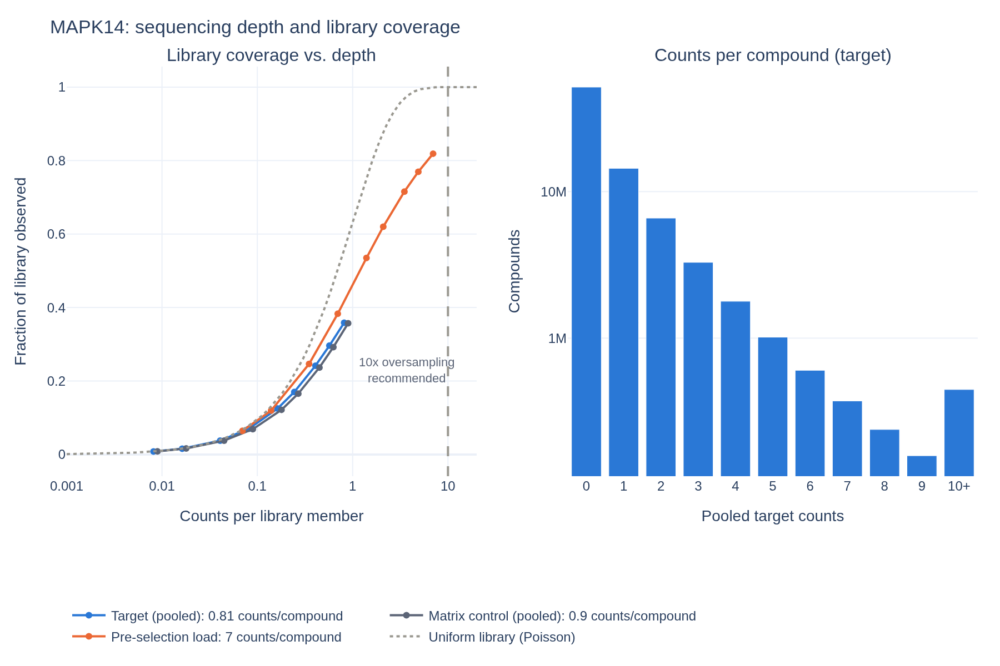
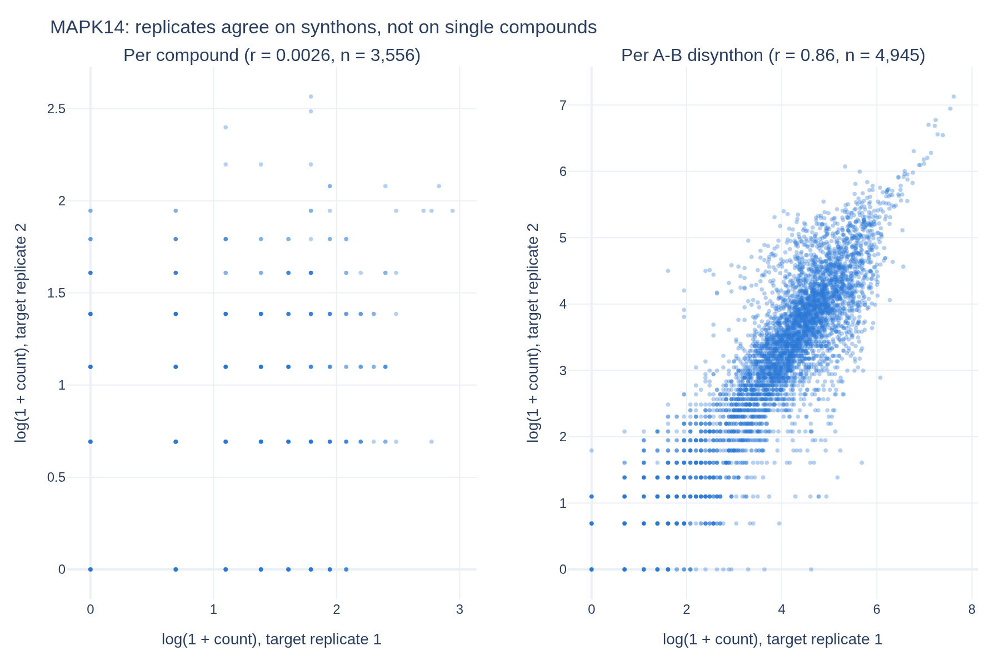
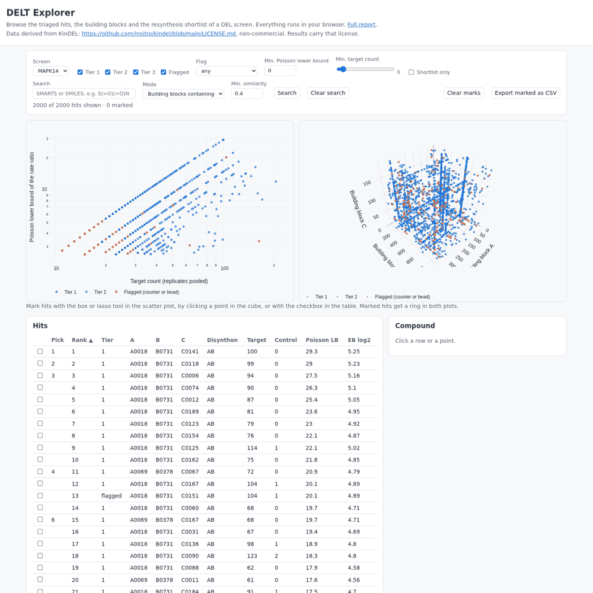

# DELT-pipeline

**Scoring DNA-encoded library (DEL) selections, checking the scores against measured binding affinities, and turning the hits into a plate a chemist can order.**

A DEL screen sequences the DNA barcodes of the compounds that survive binding to a protein. Counts are
sparse (most compounds have none) and noisy (synthesis yield, PCR, bead binding). Turning them into a
short list of real binders is a counting-statistics problem. This pipeline runs five enrichment scores
on [KinDEL](https://github.com/insitro/kindel), a public 81 M-compound library screened against two kinases
(MAPK14, DDR1) and a counter-target (BCA). It validates every score against KD values measured on
resynthesised compounds, tests every building block, and picks a diverse 96-compound resynthesis shortlist.

🔎 **[DELT Explorer](https://davidparkerch.github.io/delt-pipeline/explorer.html)** (filters, linked plots, structure search; runs in your browser) ·
📊 **[Interactive report](https://davidparkerch.github.io/delt-pipeline/)** ·
📐 **[Methods](docs/methods.md)**, including how DESeq2 thinking transfers to DEL data, and where it breaks ·
🎤 **[Five-minute walkthrough](docs/demo.md)**

## Results

### 1. The scores reproduce KinDEL's baselines

**This implementation reproduces the KinDEL paper's baselines.** The "Counts" baseline matches all four
published values exactly, and the Poisson score is within 0.02 in three of four cases. Values are
−Spearman ρ between score and measured KD (higher is better), with published values in brackets.

| Score | MAPK14 on-DNA (n=30) | MAPK14 off-DNA (n=33) | DDR1 on-DNA (n=39) | DDR1 off-DNA (n=49) |
|---|---|---|---|---|
| Counts: mean target − mean control | **0.778** (0.778) | **0.353** (0.353) | **0.695** (0.695) | **0.355** (0.355) |
| Poisson rate ratio, lower bound | 0.720 (0.737) | 0.244 (0.166) | **0.781** (0.779) | 0.450 (0.441) |
| Enrichment ratio (pseudocount) | 0.701 | 0.454 | 0.685 | **0.464** |
| Normalised z-score (Faver 2019) | 0.717 | −0.001 | 0.673 | 0.271 |
| Empirical-Bayes shrunken log2 ratio | 0.734 | **0.463** | 0.755 | 0.455 |

What the table says:

- **On-DNA, every score works** (ρ ≈ 0.7–0.8). DEL counts measure binding of the DNA-attached molecule.
- **Off-DNA**, the drug-relevant setting, depth-normalised ratios against the control (EB, ER, Poisson) beat raw
  count differences (0.45–0.46 vs 0.35). The target-only z-score, which ignores the bead control, does worst.
- With 30–49 compounds, a Spearman ρ has a standard error of about 0.15, so the ranking *among* the ratio-based scores
  is not significant. That is why the pipeline reports all of them rather than declaring a winner.

### 2. At this depth, one count says almost nothing

KinDEL's target selections are sampled at 0.6 to 0.8 counts per compound: for MAPK14, 65.8 M sequence counts
(the figure the paper reports) over 80.7 M possible compounds. Protocols ask for ten.

- **Half of the compounds seen at all were seen exactly once** (50 % for MAPK14). A single count carries almost no
  information, which is why the pipeline ranks by a lower confidence bound and asks for disynthon support.
- **The library is not uniform.** A uniform library would show 56 % of its members at this depth, and 36 % are seen.
  Even the pre-selection library, at 7 counts per compound, shows 82 % where a uniform one would show 99.9 %.
  A compound without counts is weak evidence of non-binding.



### 3. Hits are families, not compounds


*The DEL "cube" (DDR1, top 2,000 compounds by Poisson lower bound, coloured by triage tier). Each axis is one
building-block position. A line is a **disynthon**: two building blocks that bind whatever the third one is.
A line is far stronger evidence than one bright point. Orange families also bind the BCA counter-screen.*

- **Replicates agree on synthons, not on compounds.** MAPK14 target replicates correlate at r ≈ 0.00–0.08 per
  compound, but at r ≈ 0.86 once counts are summed per A–B disynthon. This is what the depth in section 2 predicts.
- **Naive enrichment ratios reward luck.** A test plants a compound with 6 counts in one replicate and none in
  the control. Naive ER ranks it above the best-supported member of a real binder family; the Poisson lower
  bound and EB shrinkage do not ([`test_planted_signal`](tests/python/test_score.py)).



### 4. Triage: tiers, flags and reasons

**Hit triage** puts each kinase's top 2,000 compounds into tiers ([`triage/hits.parquet`](docs/methods.md#7-hit-triage-analysetriagepy),
with a `reasons` column per compound). Tier 1 needs replicate support *and* an enriched disynthon,
scored **without the compound itself**, so one bright compound cannot vouch for its own family. Flagged
compounds also bind the BCA counter-screen or the beads.

| Top 2,000 ranked by | MAPK14 tier 1 | MAPK14 flagged | DDR1 tier 1 | DDR1 flagged |
|---|---|---|---|---|
| Poisson lower bound (the pipeline's ranking) | 1,755 | 170 | 1,833 | 167 |
| Normalised z-score (target only, no control) | 250 | **1,744** | 1,499 | 501 |

About 8 % of each kinase's best compounds also bind carbonic anhydrase. A score that ignores the bead
control fills MAPK14's top 2,000 with 1,744 compounds flagged as bead or counter-screen binders. Compounds that
are top hits of *both* kinases (17) are reported but not penalised: a shared hinge binder is plausible chemistry,
not promiscuity.

### 5. A shortlist a chemist can order

Resynthesis is the expensive step, and ranking alone buys redundancy: the best hits are close analogues. The
shortlist clusters the tier-1 hits by structure (Butina on Morgan fingerprints, Tanimoto ≥ 0.65) and picks the best
hit of each cluster, with at most 3 per disynthon.

| 96 compounds | MAPK14 top of the ranking | MAPK14 shortlist | DDR1 top of the ranking | DDR1 shortlist |
|---|---|---|---|---|
| Structural clusters | 17 | **96** | 29 | **96** |
| Disynthons | 5 | **62** | 21 | **58** |
| Mean pairwise similarity | 0.43 | **0.25** | 0.44 | **0.34** |

The price is stated in the [methods](docs/methods.md#7a-resynthesis-shortlist-analyseshortlistpy): the picks sit
deeper in the ranking (median rank 441 against 50 for MAPK14), but each is enriched at least 2.7-fold with 95 % confidence.

### 6. A building-block resource, and a check against known chemistry

[`blocks/blocks.parquet`](docs/methods.md#6a-building-blocks-a-searchable-resource-libraryblockspy) describes all 1,694
building blocks with RDKit (descriptors, scaffold, which blocks encode the same fragment, a synthesis-yield proxy from
the pre-selection counts). A set-enrichment test, borrowed from gene-set enrichment, asks for each block whether its
compounds rank above the rest.

**Carbonic anhydrase binds primary sulfonamides, and the BCA screen finds them without being told.** KinDEL has three
primary-sulfonamide blocks. The two para-sulfonamides rank **1st and 2nd of 1,127** B blocks in the BCA screen (AUC 0.996
and 0.990) and the meta isomer 15th. The chance of that by luck is about 2 in a million. In the kinase screens the same
blocks rank 112th to 799th. (`just known-chemistry` reproduces it.)

### 7. Does a fingerprint model help?

KinDEL found that count statistics beat machine-learning models on-DNA. The pipeline repeats the test with a
gradient-boosted Poisson regression on Morgan fingerprints, with and without the control, under a random and a
disynthon split (no training compound shares a disynthon with a validated compound).

| −Spearman vs KD | MAPK14 on | MAPK14 off | DDR1 on | DDR1 off |
|---|---|---|---|---|
| Best statistical score | **0.778** | 0.463 | **0.781** | 0.464 |
| Model, ignores the control (random split) | 0.568 | −0.126 | 0.477 | 0.151 |
| Model, weighted by the control (random split) | 0.515 | **0.557** | 0.735 | **0.493** |
| Model, weighted by the control (disynthon split) | 0.017 | 0.472 | 0.503 | 0.279 |

On-DNA, the best statistic is as good as the best model or better. Off-DNA, the model helps only when it is given the
control, and not by more than the noise (standard error ≈ 0.15). The disynthon split costs it skill, as in the paper.
A model that ignores the control learns what is abundant and what sticks to the beads.

### 8. The DELT Explorer



**[Open the explorer](https://davidparkerch.github.io/delt-pipeline/explorer.html).** One static page, no server. Filter by
screen, tier, flag, score and count; mark hits with a lasso in the scatter plot, a click in the cube or a checkbox, and
the three views stay in sync; search the building blocks by substructure (SMARTS) or the hits by similarity; open a
compound with its counts, scores and building blocks; export the marked hits as CSV. Built by `just run` into
`results/explorer.html`.


## Quick start

Requirements: [Nextflow](https://www.nextflow.io/) ≥ 26.10, Podman, [just](https://just.systems) and
[uv](https://docs.astral.sh/uv/).

```bash
just run            # synthetic library (assets/example/), a few minutes, processes run in Podman
just fetch-kindel   # download KinDEL (~21 GB, resumable, checksum-verified) into data/kindel/
just run-kindel     # MAPK14, DDR1 and BCA: about 9 minutes on a 16 GB machine (the fingerprint model takes most of it)
just known-chemistry   # where do the sulfonamide building blocks rank? (after a KinDEL run)
```

## How it works

```
samplesheet ─► SELECT_SUBLIBRARY ─► SUBSET_LIBRARY (per screen) ─► SCORE ─┬─► VALIDATE (vs measured KD)
 (KinDEL       held-out BB-As +      stream 68 M rows with polars,         ├─► MODEL (fingerprints vs KD)
  layout)      random BB-As          whole-library depth, saturation       ├─► BLOCKSET (set enrichment per block)
                                                                           ├─► AGGREGATE_SYNTHONS ─► VISUALISE ─► REPORT
                                                                           └──── all screens ──► TRIAGE ─► SHORTLIST ─► EXPLORER
                                      all screens ─► BUILDING_BLOCKS (RDKit resource) ─────────────────────────────────┘
                        hits, shortlist, blocks ─► EXPORT ─► CHECKSUM ─► DESCRIBE (FAIR)
```

- **Sub-library, unbiased where it matters.** The pipeline keeps every BB-A used by a validated compound, plus random
  BB-As (60 of 377, about 11 M compounds per screen). Normalising depth comes from the **whole** screen, and
  library-wide priors are fitted on the random BB-As only.
- **Five scores** in [`analyse/enrichment.py`](src/delt_pipeline/analyse/enrichment.py), all vectorised.
  The Poisson interval is exact (conditional binomial, Clopper–Pearson) and is mapped back to a rate ratio
  through the depth ratio, so "no enrichment" means π₀ = E_t/(E_t+E_c), not 0.5.
- **Memory-aware.** Each screen is streamed, never loaded whole (peak 3.9 GB per 7 GB file). Process labels
  and the `local` profile budget memory against the machine's real capacity, so tasks queue instead of
  oversubscribing RAM.

## Engineering

| | |
|---|---|
| Workflow | Nextflow 26.10 strict syntax: static types, records, topic channels, workflow outputs, data lineage; 17 typed modules |
| Code | Python package `delt_pipeline` (polars, SciPy, scikit-learn, RDKit, plotly, jinja2); thin CLI, pure functions |
| Tests | pytest with **100 % line and branch coverage**; nf-test for every module, the workflow and the pipeline (real data, stub, versions); byte-stable snapshots |
| Explorer | Python builds the data and page (100 % covered); about 450 lines of JavaScript are glue with no unit tests, checked instead by a headless-browser smoke test against RDKit in Python (`just smoke-explorer`, needs a browser, not in CI) |
| Test data | A seeded simulator in the KinDEL layout with planted binders, a bead binder, a promiscuous compound and a low-count outlier |
| Containers | Podman runtime and dev images from one `Containerfile`; CI builds and tests in the runtime image |
| FAIR | schema.org JSON-LD and Frictionless data packages with SHA-256, EDAM formats and a column dictionary; RO-Crate and BioCompute provenance; `just validate-fair` |
| Tooling | `just`, uv, ruff, GitHub Actions (lint, pytest, nf-test, FAIR validation, Pages, releases to GHCR) |

<details>
<summary>Input, parameters and outputs</summary>

**Samplesheet** (CSV), one row per selection screen in the KinDEL layout. See `assets/kindel/samplesheet.csv`.

| Column | Required | Description |
|---|---|---|
| `id` | yes | Screen id |
| `table` | yes | Parquet with `smiles`, `molecule_hash`, `smiles_{a,b,c}`, `seq_target_{1,2,3}`, `seq_matrix_{1,2,3}`, `seq_load` |
| `target` | yes | Protein name; `mapk14` and `ddr1` enable the published-baseline comparison |
| `role` | yes | `target` or `counter` |
| `heldout_ondna`, `heldout_offdna` | no | KD tables (`molecule_hash`, `kd`) for validation |
| `description`, `source`, `license`, `keywords` | no | FAIR metadata |

| Parameter | Default | Description |
|---|---|---|
| `--input` | (required) | Samplesheet |
| `--synthons` | (required) | Folder with `reacted_{a,b,c}.csv` (building blocks) |
| `--n_bb_a` | `60` | BB-As in the sub-library (`377` = whole library) |
| `--alpha` | `0.5` | Pseudocount of the enrichment ratio |
| `--ci_level` | `0.95` | Confidence level of the Poisson interval |
| `--top_n` | `2000` | Compounds in each published hit table |
| `--export_formats` | `parquet,tsv` | Also `arrow`, `csv`, `jsonl`, `npz` |
| `--n_picks` | `96` | Compounds on each target screen's resynthesis shortlist |
| `--cluster_similarity` | `0.65` | Tanimoto similarity (Morgan fingerprints) at or above which two hits share a cluster |
| `--max_per_cluster`, `--max_per_disynthon` | `2`, `3` | Picks per structural cluster and per disynthon at most |
| `--seed` | `42` | Seed for the random BB-As and the model |
| `--report_title`, `--explorer_title` | `DELT-pipeline report`, `DELT Explorer` | Titles of the two HTML pages |

```
results/
├── report.html                 # standalone HTML report (validation, model, triage, figures)
├── explorer.html               # the DELT Explorer: one static page
├── sublibrary.json             # chosen BB-As (held-out and random)
├── screens/<id>/               # counts_qc (with depth and saturation), scores (all compounds), top, synthons,
│                               #   blockset (set enrichment per building block), validation, model, figures, metadata.jsonld
├── triage/                     # hits.parquet (tiers, flags, reasons), triage_qc.json, triage.metadata.jsonld
├── shortlist/                  # picks.parquet (diverse resynthesis shortlist), picks_qc.json, metadata
├── blocks/                     # blocks.parquet (RDKit-described building blocks), blocks_qc.json, metadata
├── exports/<id>/               # <id>_hits.{parquet,tsv}, SHA256SUMS, datapackage.json (also triage, shortlist, building_blocks)
└── pipeline_info/              # versions, trace, timeline, BioCompute Object, DAG
```
</details>

## Development

```bash
just            # list commands
just fmt        # format Python and Nextflow
just ci         # lint and every test (pytest 100 % coverage, nf-test snapshots, test coverage)
```

Conventions for contributors and coding agents are in [AGENTS.md](AGENTS.md).

## Licenses

- **Code:** Apache-2.0 ([LICENSE](LICENSE)).
- **Synthetic example data** (`assets/example/`): CC0-1.0.
- **KinDEL data and everything derived from it** (the hosted report, `docs/img/`, results of `just run-kindel`):
  [CC BY-NC-SA 4.0 with insitro's terms](https://github.com/insitro/kindel/blob/main/LICENSE.md), for
  non-commercial research and education only. The data itself is never committed.
- KinDEL: Chen B., Danel T., et al. *KinDEL: DNA-Encoded Library Dataset for Kinase Inhibitors.* ICML 2025,
  [arXiv:2410.08938](https://arxiv.org/abs/2410.08938).
