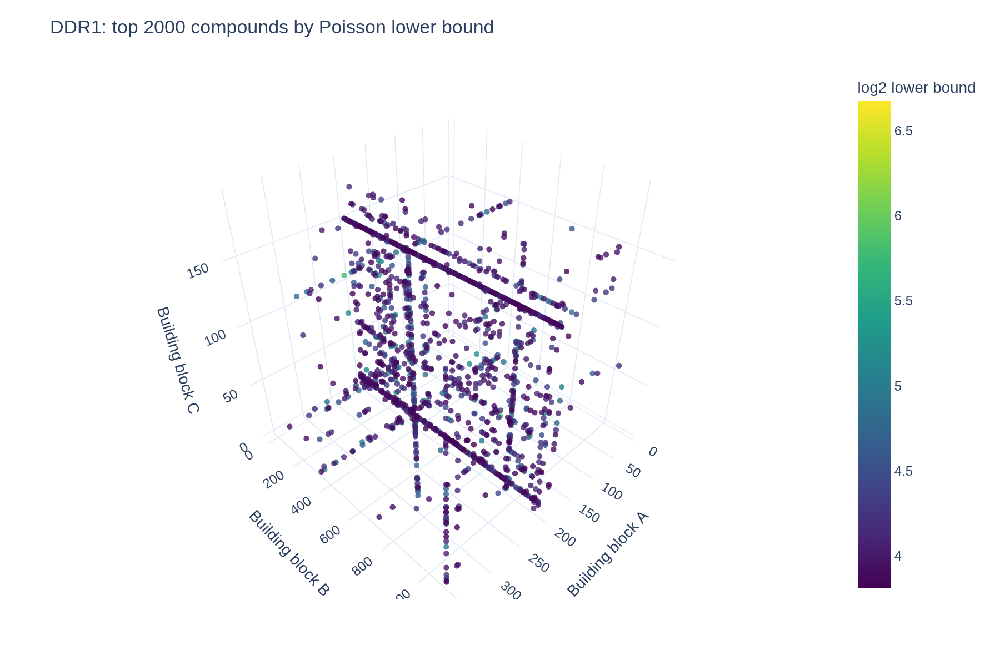

# DELT-pipeline

**Scoring DNA-encoded library (DEL) selections, and checking the scores against measured binding affinities.**

A DEL screen sequences the DNA barcodes of the compounds that survive binding to a protein. Counts are
sparse (most compounds have none) and noisy (synthesis yield, PCR, bead binding). Turning them into a
short list of real binders is a counting-statistics problem. This pipeline runs five enrichment scores
on [KinDEL](https://github.com/insitro/kindel), a public 81 M-compound library screened against two kinases
(MAPK14, DDR1) and a counter-target (BCA). It then validates every score against KD values measured on
resynthesised compounds.

📊 **[Interactive report](https://davidparkerch.github.io/delt-pipeline/)** (no install needed) ·
📐 **[Methods](docs/methods.md)**, including how DESeq2 thinking transfers to DEL data, and where it breaks

## Results

**This implementation reproduces the KinDEL paper's baselines.** The "Counts" baseline matches all four
published values exactly, and the Poisson score is within 0.02 in three of four cases. Values are
−Spearman ρ between score and measured KD (higher is better), with published values in brackets.

| Score | MAPK14 on-DNA (n=30) | MAPK14 off-DNA (n=33) | DDR1 on-DNA (n=39) | DDR1 off-DNA (n=49) |
|---|---|---|---|---|
| Counts: mean target − mean control | **0.778** (0.778) | **0.353** (0.353) | **0.695** (0.695) | **0.355** (0.355) |
| Poisson rate ratio, lower bound | 0.720 (0.737) | 0.244 (0.166) | **0.781** (0.779) | 0.450 (0.441) |
| Enrichment ratio (pseudocount) | 0.701 | 0.454 | 0.685 | **0.464** |
| Normalised z-score (Faver 2019) | 0.717 | −0.001 | 0.673 | 0.271 |
| Empirical-Bayes shrunken log2 ratio | 0.734 | **0.463** | 0.755 | 0.455 |

What the table says:

- **On-DNA, every score works** (ρ ≈ 0.7–0.8). DEL counts measure binding of the DNA-attached molecule.
- **Off-DNA**, the drug-relevant setting, depth-normalised ratios against the control (EB, ER, Poisson) beat raw
  count differences (0.45–0.46 vs 0.35). The target-only z-score, which ignores the bead control, does worst.
- With 30–49 compounds, a Spearman ρ has a standard error of about 0.15, so the ranking *among* the ratio-based scores
  is not significant. That is why the pipeline reports all of them rather than declaring a winner.



*The DEL "cube" (DDR1, top 2,000 compounds by Poisson lower bound). Each axis is one building-block position.
A line is a **disynthon**: two building blocks that bind whatever the third one is. A line is far stronger
evidence than one bright point.*

Two more findings from the data (details in [methods](docs/methods.md)):

- **Replicates agree on synthons, not on compounds.** Target replicates correlate at r ≈ 0.01–0.08 per compound
  (MAPK14), but at r ≈ 0.85–0.87 once counts are summed per A–B disynthon.
- **Naive enrichment ratios reward luck.** A test plants a compound with 6 counts in one replicate and none in
  the control. Naive ER ranks it above the best-supported member of a real binder family; the Poisson lower
  bound and EB shrinkage do not ([`test_planted_signal`](tests/python/test_score.py)).

## Quick start

Requirements: [Nextflow](https://www.nextflow.io/) ≥ 26.10, Podman, [just](https://just.systems) and
[uv](https://docs.astral.sh/uv/).

```bash
just run            # synthetic library (assets/example/), about a minute, processes run in Podman
just fetch-kindel   # download KinDEL (~21 GB, resumable, checksum-verified) into data/kindel/
just run-kindel     # MAPK14, DDR1 and BCA: about 2 minutes on a 16-thread, 16 GB machine
```

## How it works

```
samplesheet ─► SELECT_SUBLIBRARY ─► SUBSET_LIBRARY (per screen) ─► SCORE ─┬─► VALIDATE ─► VISUALISE ─┐
 (KinDEL       held-out BB-As +      stream 68 M rows with polars,         │   vs measured KD          ├─► REPORT
  layout)      random BB-As          whole-library depth, 11 M kept        └─► EXPORT ─► CHECKSUM ─► DESCRIBE (FAIR)
```

- **Sub-library, unbiased where it matters.** The pipeline keeps every BB-A used by a validated compound, plus random
  BB-As (60 of 377, about 11 M compounds per screen). Normalising depth comes from the **whole** screen, and
  library-wide priors are fitted on the random BB-As only.
- **Five scores** in [`analyse/enrichment.py`](src/delt_pipeline/analyse/enrichment.py), all vectorised.
  The Poisson interval is exact (conditional binomial, Clopper–Pearson) and is mapped back to a rate ratio
  through the depth ratio, so "no enrichment" means π₀ = E_t/(E_t+E_c), not 0.5.
- **Memory-aware.** Each screen is streamed, never loaded whole (peak 3.9 GB per 7 GB file). Process labels
  and the `local` profile budget memory against the machine's real capacity, so tasks queue instead of
  oversubscribing RAM.

## Engineering

| | |
|---|---|
| Workflow | Nextflow 26.10 strict syntax: static types, records, topic channels, workflow outputs, data lineage |
| Code | Python package `delt_pipeline` (polars, SciPy, plotly, jinja2); thin CLI, pure functions |
| Tests | pytest with **100 % line and branch coverage**; nf-test for every module, the workflow and the pipeline (real data, stub, versions); byte-stable snapshots |
| Test data | A seeded simulator in the KinDEL layout with planted binders, a bead binder, a promiscuous compound and a low-count outlier |
| Containers | Podman runtime and dev images from one `Containerfile`; CI builds and tests in the runtime image |
| FAIR | schema.org JSON-LD and Frictionless data packages with SHA-256, EDAM formats and a column dictionary; RO-Crate and BioCompute provenance; `just validate-fair` |
| Tooling | `just`, uv, ruff, GitHub Actions (lint, pytest, nf-test, FAIR validation, Pages, releases to GHCR) |

<details>
<summary>Input, parameters and outputs</summary>

**Samplesheet** (CSV), one row per selection screen in the KinDEL layout. See `assets/kindel/samplesheet.csv`.

| Column | Required | Description |
|---|---|---|
| `id` | yes | Screen id |
| `table` | yes | Parquet with `smiles`, `molecule_hash`, `smiles_{a,b,c}`, `seq_target_{1,2,3}`, `seq_matrix_{1,2,3}`, `seq_load` |
| `target` | yes | Protein name; `mapk14` and `ddr1` enable the published-baseline comparison |
| `role` | yes | `target` or `counter` |
| `heldout_ondna`, `heldout_offdna` | no | KD tables (`molecule_hash`, `kd`) for validation |
| `description`, `source`, `license`, `keywords` | no | FAIR metadata |

| Parameter | Default | Description |
|---|---|---|
| `--input` | (required) | Samplesheet |
| `--synthons` | (required) | Folder with `reacted_{a,b,c}.csv` (building blocks) |
| `--n_bb_a` | `60` | BB-As in the sub-library (`377` = whole library) |
| `--alpha` | `0.5` | Pseudocount of the enrichment ratio |
| `--ci_level` | `0.95` | Confidence level of the Poisson interval |
| `--top_n` | `2000` | Compounds in each published hit table |
| `--export_formats` | `parquet,tsv` | Also `arrow`, `csv`, `jsonl`, `npz` |
| `--seed` | `42` | Seed for the random BB-As |

```
results/
├── report.html                 # standalone HTML report
├── sublibrary.json             # chosen BB-As (held-out and random)
├── screens/<id>/               # counts_qc, scores (all compounds), top, score_qc, validation, figures, metadata.jsonld
├── exports/<id>/               # <id>_hits.{parquet,tsv}, SHA256SUMS, datapackage.json
└── pipeline_info/              # versions, trace, timeline, BioCompute Object, DAG
```
</details>

## Development

```bash
just            # list commands
just fmt        # format Python and Nextflow
just ci         # lint and every test (pytest 100 % coverage, nf-test snapshots, test coverage)
```

Conventions for contributors and coding agents are in [AGENTS.md](AGENTS.md).

## Licenses

- **Code:** Apache-2.0 ([LICENSE](LICENSE)).
- **Synthetic example data** (`assets/example/`): CC0-1.0.
- **KinDEL data and everything derived from it** (the hosted report, `docs/img/`, results of `just run-kindel`):
  [CC BY-NC-SA 4.0 with insitro's terms](https://github.com/insitro/kindel/blob/main/LICENSE.md), for
  non-commercial research and education only. The data itself is never committed.
- KinDEL: Chen B., Danel T., et al. *KinDEL: DNA-Encoded Library Dataset for Kinase Inhibitors.* ICML 2025,
  [arXiv:2410.08938](https://arxiv.org/abs/2410.08938).
